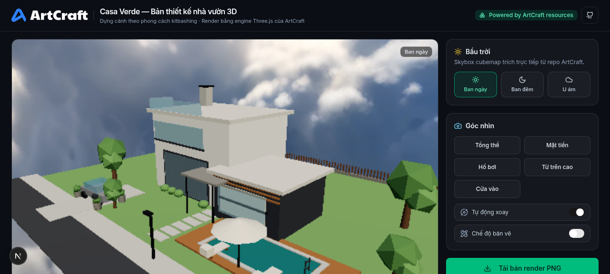
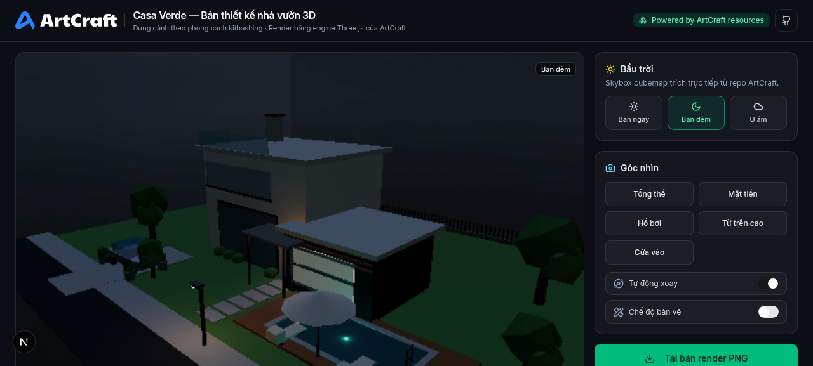
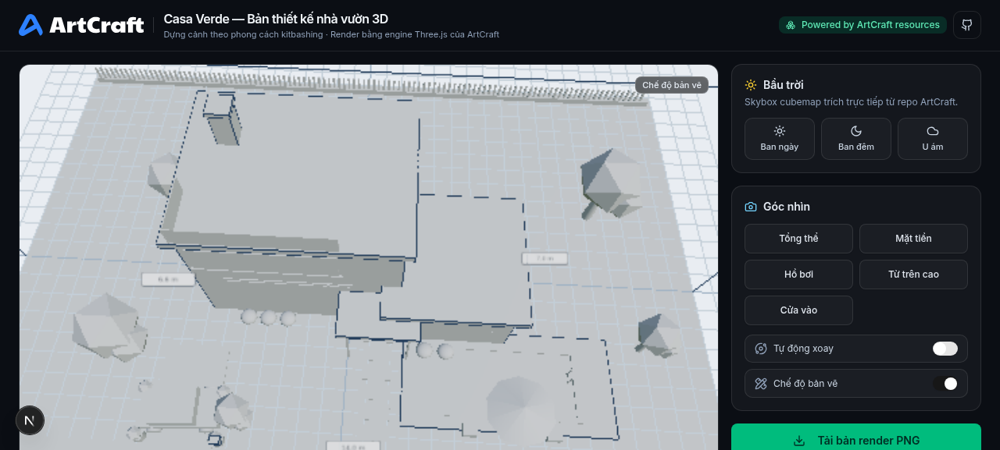
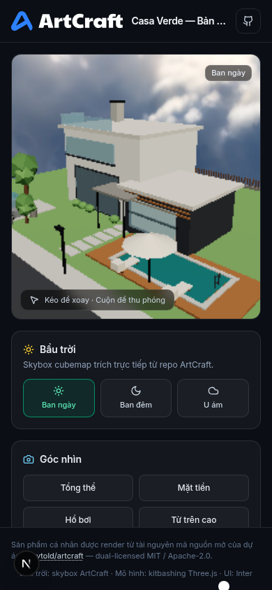

<div align="center">

# 🏡 Casa Verde — Bản thiết kế nhà vườn 3D

**Sản phẩm cá nhân render bằng tài nguyên mã nguồn mở từ [ArtCraft](https://github.com/storytold/artcraft) — "The IDE for artists"**

Một bản thiết kế biệt thự vườn 3D tương tác, dựng hoàn toàn trong trình duyệt bằng engine Three.js, sử dụng skybox cubemap, font chữ và ngôn ngữ thiết kế lấy từ dự án ArtCraft của Storytold.



</div>

---

## 📖 Bối cảnh

Dự án này được thực hiện như một bài thực hành: **"render một sản phẩm cá nhân — một bản thiết kế nhà — nhờ tài nguyên mà dự án ArtCraft cung cấp"**. ArtCraft là IDE dành cho nghệ sĩ (Rust + Tauri + React/Remix) hỗ trợ soạn cảnh 2D/3D và sinh ảnh/video bằng hơn 62 model AI. Thay vì dùng ArtCraft như một ứng dụng desktop, dự án này **tái sử dụng trực tiếp các tài nguyên kỹ thuật** của nó (xem bảng bên dưới) để dựng một ứng dụng web độc lập bằng Next.js 16 + React 19 + Three.js.

## ✨ Tính năng

- **Villa 2 tầng hiện đại** dựng bằng kỹ thuật *kitbashing* ~130 khối hình học: thân trắng 2 tầng, khối phụ màu than chì, mái bằng, mặt tiền kính, ốp gỗ, ban công
- **Hồ bơi 6×3.1 m** với mặt nước bán trong suốt + sân gỗ, hàng rào, cổng, xe, đèn đường, hòm thư, cây xanh và chậu cảnh
- **3 trạng thái bầu trời** chuyển mượt: ban ngày / hoàng hôn về đêm / u ám — dùng skybox cubemap 6 mặt của ArtCraft kèm nội suy ánh sáng, bóng đổ PCF và PMREM environment
- **5 góc nhìn nhanh** (mặt tiền, hồ bơi, ban công, trên cao, đường phố) với camera tween mượt + chế độ orbit tự do
- **Chế độ bản vẽ kỹ thuật**: chuyển sang clay render, bật wireframe cạnh, lưới đất và nhãn kích thước (chiều ngang 14.5 m, sâu 12.0 m, cao 7.2 m)
- **Xuất ảnh PNG** độ phân giải gốc canvas chỉ với một nút bấm
- **Tối ưu thiết bị yếu**: phát hiện SwiftShader, tự hạ chất lượng, hỗ trợ chế độ `?lite=1` (render theo yêu cầu) và `?static=1` cho máy ảo / CI
- **Responsive** đầy đủ cho màn hình desktop lẫn mobile

| Ban đêm | Bản vẽ kỹ thuật |
| --- | --- |
|  |  |

| Mobile 390×844 | Góc nhìn trên cao |
| --- | --- |
|  | *(xem trực tiếp trong app)* |

## 🧩 Tài nguyên sử dụng từ ArtCraft

| Tài nguyên | Vị trí trong ArtCraft | Cách dùng trong dự án này |
| --- | --- | --- |
| Skybox cubemap ngày/đêm/u ám (`.webp`, 6 mặt) | `frontend/public/skybox/` | Nền trời 3D + ánh sáng môi trường (PMREM) |
| Engine Three.js (`^0.162`) | `frontend/package.json` | Nâng cấp lên `three@0.186` để dựng toàn bộ cảnh |
| Font **Inter Variable** | `artcraft-native/` | Toàn bộ UI theo chuẩn typography của ArtCraft |
| Logo & icon | `frontend/public/` | Favicon + credit UI "Powered by ArtCraft resources" |
| Ngôn ngữ thiết kế IDE tối | `frontend/src/` | Giao diện panel điều khiển phong cách dark IDE |

## 🚀 Cài đặt & chạy

Yêu cầu: Node.js 20+ (hoặc Bun 1.2+).

```bash
# 1. Cài dependencies
bun install        # hoặc: npm install

# 2. Chạy môi trường phát triển
bun run dev        # hoặc: npm run dev
# → mở http://localhost:3000

# 3. Build production
bun run build      # hoặc: npm run build
bun run start      # hoặc: npm run start
```

### Tham số URL hữu ích

| Tham số | Ý nghĩa |
| --- | --- |
| `?lite=1` | Render theo yêu cầu (on-demand) — tiết kiệm pin/CPU, phù hợp máy yếu |
| `?static=1` | Như `lite`, cố định bầu trời ban ngày — dùng cho chụp ảnh tự động/CI |

## 🗂️ Cấu trúc mã nguồn

```
src/
├── app/
│   ├── layout.tsx          # Metadata + font Geist/Inter
│   ├── page.tsx            # Trang chính, header phong cách ArtCraft IDE
│   └── globals.css         # Theme Tailwind v4 (dark)
├── components/
│   └── HouseViewer.tsx     # UI điều khiển: trời, camera, chế độ, xuất ảnh
├── hooks/
│   └── use-toast.ts
└── lib/three-house/
    ├── build-house.ts      # Kitbashing ~130 khối: nhà, hồ bơi, cây, hàng rào…
    └── house-scene.ts      # Engine: skybox cubemap, ánh sáng, camera tween, xuất PNG
public/artcraft/            # Tài nguyên copy từ dự án ArtCraft
preview/                    # Ảnh chụp minh họa
```

## 🛠️ Công nghệ

[](https://nextjs.org)
[](https://react.dev)
[](https://threejs.org)
[](https://tailwindcss.com)
[](https://www.typescriptlang.org)

## 🙏 Credit & giấy phép

- Dự án gốc **[ArtCraft](https://github.com/storytold/artcraft)** của [Storytold](https://github.com/storytold) — *The IDE for artists*, license kép **MIT / Apache-2.0**.
- Tài nguyên skybox, font, logo được dùng lại theo đúng điều khoản license của dự án gốc (xem [LICENSE](LICENSE)).
- Phần mã nguồn trong repo này được phát hành theo **MIT License**.
